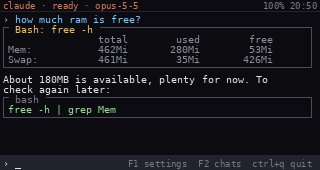
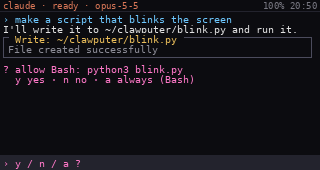
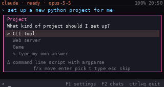
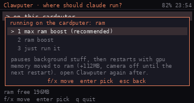
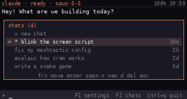
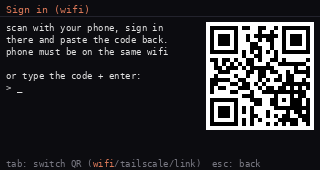

# Clawputer

**Claude Code in your pocket.** A chat app for Anthropic's [Claude Code](https://claude.com/claude-code)
made for the [M5Stack CardputerZero](https://docs.m5stack.com/en/CardputerZero)'s 320x170 screen
and built-in keyboard.

> Unofficial. Not affiliated with or endorsed by Anthropic. Claude and Claude Code are
> trademarks of Anthropic.

| | | |
|---|---|---|
|  |  |  |
|  |  |  |

## Features

- **Chat view** built for a tiny screen: tool calls squashed to one line, command output and
  code blocks in single-line boxes, word wrap, scroll bar
- **Permission prompts** (`y` / `n` / `a`lways) and Claude's **multiple-choice questions**
- **Chat history** (F3), opens your last chat on start, delete old ones
- **Settings** (F2): model, effort, permission mode, font size, tool output lines, Enter =
  send / new line, double-space full stop
- **Drafts autosave**, messages typed while Claude is busy are queued in order
- **Easy setup**: installs Claude Code with Anthropic's official installer, then sign in by
  **scanning a QR code with your phone** and pasting the code there (wifi, Tailscale, or
  straight to Claude's sign-in page)
- **Remote mode**: run Claude on your PC over SSH (Tailscale works great) and use the
  Cardputer as the screen; fast, no RAM limits. Set up with one short command on the PC
- **Optional RAM boost** for running Claude on the Cardputer itself (see below)

## Keys (chat)

| key | does |
|---|---|
| type + Enter | send (or new line, see settings; then Ctrl+Enter / Enter twice sends) |
| Fn+F / Fn+X | scroll one line up / down |
| Fn+Z / Fn+C | page up / down |
| Esc | stop Claude's current reply, or clear the message box |
| F1 | help (all the keys) |
| F2 / Ctrl+S | settings (`f`/`x` move, Enter open, Esc back) |
| F3 / Ctrl+O | chats (`n` new, `d` delete) |
| Ctrl+Q or `/exit` | quit (`/new` starts a fresh chat) |

### Web UI (phone / PC)

F2 > **web ui: start / stop** serves the chat to any browser on your network (set **web ui on
open** to start it every time). The Cardputer shows the address, a key and a QR code: scan it,
or open the address and type the key. You get the live chat, a message box, tap-to-answer
permission prompts, questions and sudo popups, your chats, settings, and a mirror of the
Cardputer's screen with its keys. It's plain HTTP protected by the key: fine at home or over
Tailscale, but avoid typing a sudo password through it on shared Wi-Fi.

## Running on the Cardputer vs on a PC

Claude Code wants ~200MB of RAM; the CardputerZero has ~350MB usable. It works, but it's
tight. Two ways to make it better:

- **RAM boost** (optional): when you pick *on this cardputer* you choose **max ram boost**
  (recommended), **ram boost** or **just run it**. Boosting asks your password once. It installs two small root helpers and a sudoers rule so Clawputer can pause
  background services (desktop, printing, etc., list in `/etc/clawputer/boost.conf`) while
  Claude runs, and offer a one-boot reboot that moves GPU memory to RAM (+~112MB, camera off
  for that boot; the next reboot is back to normal automatically). Undo with
  `sudo clawputer-boost-uninstall` (works even after uninstalling the app; do this before
  removing Clawputer if you want everything gone).
- **Remote mode**: pick *on my pc* on the start screen. It shows **one short command** to type
  into an admin PowerShell (or a Mac/Linux terminal) on the PC: it fetches a setup script from
  the Cardputer that enables SSH with the Cardputer's key and reports the PC's address back,
  so there's nothing to copy between devices. A QR code to a step-by-step page is there too.
  Claude then runs on your PC in `~/clawputer` and the Cardputer is just the screen.

## Privacy & security notes

- Sign-in uses Claude Code's own `claude auth login`. The setup page is served by the
  Cardputer on your local network only while the setup screen is open, behind a random URL
  token. Your sign-in code goes from your phone to the Cardputer and straight into Claude Code.
- Remote mode uses a dedicated SSH key (`~/.config/clawputer/remote_key`). Remote Claude can
  do whatever your PC account can; keep permissions on **ask** unless you're sure.
- The app itself never runs as root. The RAM boost is opt-in and fully removable.

## Building

On the CardputerZero (or any Debian box with `dpkg-deb`):

```sh
./build-deb.sh        # -> dist/clawputer_<version>_all.deb
sudo apt install ./dist/clawputer_*_all.deb
```

Files: launcher `/usr/share/APPLaunch/bin/clawputer`, app `/usr/share/clawputer/`,
config `~/.config/clawputer/`, chats run in `~/clawputer`.

## License

MIT
